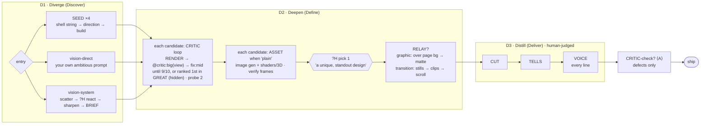
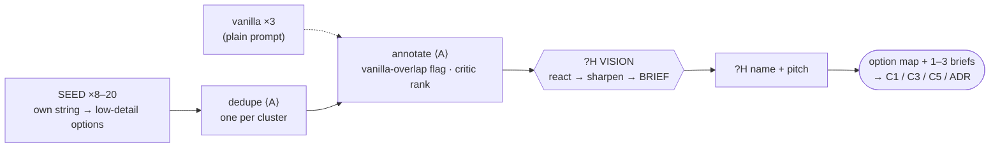
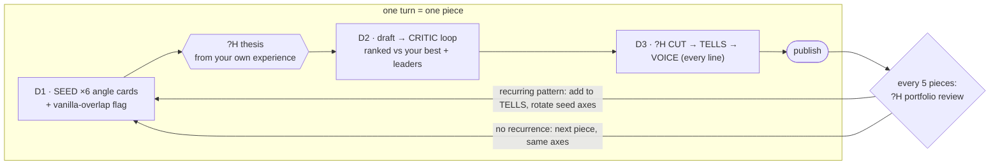
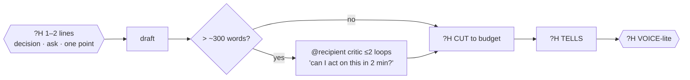
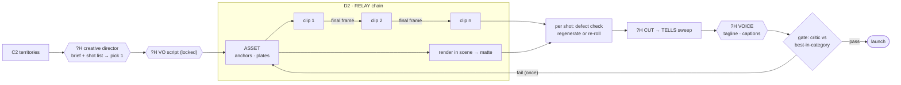
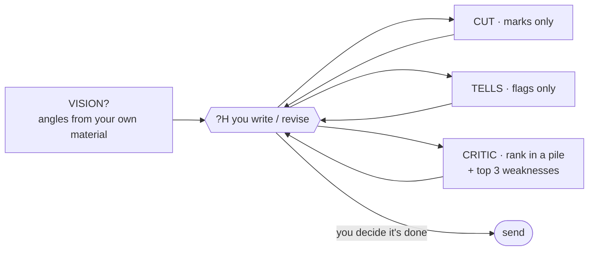
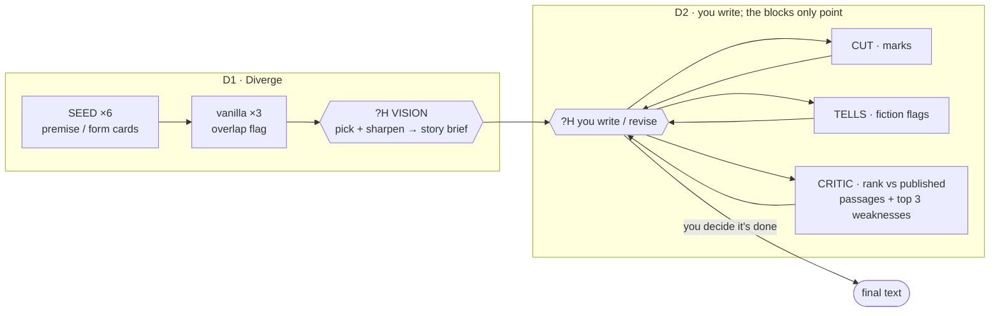
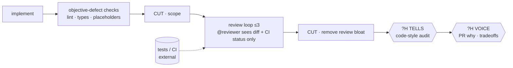
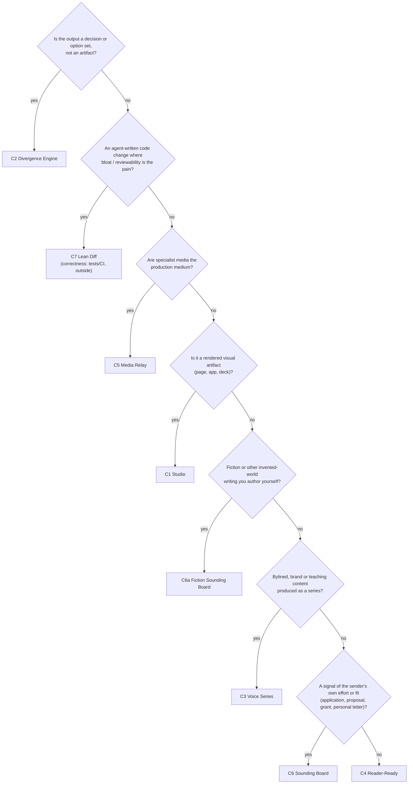

# 03 · Configurations

A **configuration** wires the [blocks](01-blocks.md) onto the [chassis](02-grammar.md#1-the-chassis-diverge--deepen--distill) for one family of use cases. Each is grounded in [04-use-case-evidence.md](04-use-case-evidence.md) and states:

- the pain it addresses, including counter-evidence (or "none found"), and the market reality;
- its **wiring**, in notation and as a diagram;
- which blocks are central, optional or reduced, and which **sit out** and why;
- its stop rules and cost, including a **lite** profile;
- success criteria, judged by an evaluator **other than the loop's own critic**;
- any **declared exceptions** to the default rules;
- every amendment to the article, marked ⟨A⟩.

There are seven configurations, plus **C6a**, a fiction variant of C6. They differ in **topology**, not just settings:

| # | Configuration | Topology | Serves | Thesis fit |
|---|---|---|---|---|
| C1 | **Studio** | Parallel seeded fan-out → critic loop per candidate → image enrichment (ASSET) → human pick → optional video (RELAY) → human-led distill | AI-built interfaces · decks · brand-system UI | **The article's own** |
| C2 | **Divergence Engine** | Wide fan-out → dedupe → annotate → human pick. Ends in a *decision*. **Can run as the front end of C1, C3 and C5** | Strategy options, concepts, naming territories, research ideas | Core |
| C3 | **Voice Series** | An **outer loop across a series**, where a periodic portfolio review feeds the next round's seeds | Bylined and brand writing · teaching units | Core |
| C4 | **Reader-Ready** | A short linear chain built to take minutes; recipient-critic only for long documents | Internal memos, PRDs, updates, RCAs | Partial |
| C5 | **Media Relay** | A specialist chain *is* the medium; state handoff; per-shot defect checks; one-shot pre-launch gate | Ad creative · *(provisional)* brand imagery · creator video | Core |
| C6 | **Sounding Board** | **Inverted**: the human writes, and blocks audit in parallel (annotations only) | Cover letters, proposals, grants, essays, relational posts | Core (via VISION/VOICE) |
| C6a | **Fiction Sounding Board** *(variant of C6)* | Seeded premise/form fan-out → human pick → C6's inverted loop, with a fiction tell catalog and published-passage references | Short stories, novels, serials, scripts | Core |
| C7 | **Lean Diff** | Convergent; subtraction on *both* sides of a review loop | Agent-written code changes | **Adjacent** |

*A headless, platform-level "guardrail" configuration was considered. It depends mostly on off-path capabilities (a learned ranker, cross-project similarity metrics, best-of-N selection) and has no human taste in the loop, so it now lives in [05 · channel candidate](05-more-to-explore.md#j-channel-candidate-platform-guardrail).*

### Block coverage

`●` central · `○` optional · `◐` reduced · `—` sits out

| | SEED | VISION | CRITIC | ASSET | RELAY | CUT | TELLS | VOICE |
|---|---|---|---|---|---|---|---|---|
| C1 Studio | ● *(one entry per run)* | ● *(one entry per run)* | ● | ● *(when "plain")* | ○ | ● | ● | ● |
| C2 Divergence Engine | ● | ● | ◐ annotation only | ○ | — | — | — | ◐ name + pitch |
| C3 Voice Series | ● angles | ● thesis | ● | ○ | — | ● | ● | ● heavy |
| C4 Reader-Ready | — | ◐ one line | ○ long docs | ○ charts from data only | — | ● | ● | ◐ key lines |
| C5 Media Relay | ● via C2 | ● | ● one-shot gate | ● | ● | ● | ● | ● |
| C6 Sounding Board | — | ○ own material | ● rank in pile | — | — | ◐ marks | ◐ flags | ● whole document |
| C6a Fiction Sounding Board | ● premise/form | ● story brief | ● rank vs published | — | — | ◐ marks | ◐ fiction flags | ● whole text |
| C7 Lean Diff | — | ◐ spec interview | ● reviewability | — | — | ● ×2 | ● D3 audit | ◐ PR "why" |

### Ordering principle and declared exceptions

> **By default, CRITIC lives in D2. CUT, TELLS and VOICE live in D3, in that order.** Critic loops add material, so subtraction runs *after* the last critic loop. The tell catalog never enters a generation, regeneration or critic prompt ([port rule 7](02-grammar.md#port-rules-hard-invariants)).

| Configuration | Default relaxed | What happens instead | Why |
|---|---|---|---|
| C1 | Rules 2 and 7 | The article-faithful default keeps all k candidates through D2 before the firm pick; a score-free, defect-only `CRITIC-check` runs after D3, and its failures go to `?H` | The article ran all 4 seeded drafts through the critic; the lite profile picks early. The check judges no taste |
| C2 | Rule 4; stage placement | CRITIC runs once, as an annotation; VOICE and ASSET run inside D1 | The output is a decision, and the human picks. C2 is a D1-only configuration |
| C4 | Rule 9 | VOICE-lite: the owner reads every line but rewrites only the key lines (bottom line, ask, judgment calls, sign-off). Fully transactional text gets key lines only | Transactional AI-assisted text keeps trust even when disclosed (Purcell et al. 2025); the time budget is minutes |
| C5 | Rule 7 (ordering) | The VO script is written and locked in D1, right after the pick; defect checks run per shot in D2; the critic is a one-shot gate *after* D3, with one automatic retry of D2 (`↺`) | The relay generates audio from the script. Iteration happens per shot. D3 CUT may drop whole VO lines only with the owner's sign-off |
| C6 | Rules 4 and 7 | No hidden threshold (the human decides when it's done); CUT, TELLS and CRITIC run as parallel annotation-only auditors in D2 | The human is the author; auditors delete nothing, so order doesn't matter |
| C6a | Rules 4 and 7 | The same as C6 | The same as C6 |
| C7 | Port rule 1; rule 7 | The render is the diff; CUT also runs in D2, before and after the review loop | For code, the diff *is* what a reviewer experiences. Reviews add material |

---

## C1 · Studio: the article's configuration

*"A distinctive interface, built by agents, finished by a human."* Serves AI-built landing pages, marketing sites, MVP and product UI, and prototypes. **Deck mode** covers presentations. **Brand-system mode** covers UI built inside an existing design system.

### Grounding
- **Pain**
  - In a scan of 1,590 Show HN sites, 22% showed four or more of 16 AI design patterns and another 32% showed two or three (Krebs, Apr 2026).
  - Anthropic attributes the Inter/purple-gradient look to "distributional convergence," and its own frontend skill now has to list *second-order* defaults.
  - 52.2% of designers cite AI output quality as a blocker, and 34.2% heavily edit first drafts (UX Tools 2026, n=1,478).
  - Agents "confidently" praise their own mediocre design, and a separate evaluator was far more tractable (Anthropic, Mar 2026).
- **Why the critic needs anchoring.** General vision models judged UI quality near chance (GPT-4V 51.6% vs. 75.1% for a specialized critic; UIClip, UIST 2024, older models).
- **Counter-evidence.** Users prefer simple, prototypical layouts at first impression, and unfamiliar designs look less attractive (Tuch et al., via Google Research). This is why C1 offers an opt-in `structure=conservative` knob, untested for conversion.
- **Market** *(unverified estimates)*
  - Lovable at about $400M ARR (Feb 2026), Replit at $525M annualized, v0 at 4M users.
  - Incumbents sell design-system grounding, which buys consistency rather than distinctiveness.
  - Anti-slop demand lives in open-source skills (Impeccable has 77.1k stars).
  - **Gap:** no conversion A/B evidence that distinctive beats generic.

### Wiring (article-faithful defaults; ⟨A⟩ marks additions)

```
D1:: route(entry){
       seed:          x4[ SEED(shell string) > build:mid ]
     | vision-direct: ?H ambitious-prompt(own reference [+ "still works as a landing page" ⟨A⟩]) > xk[ build:mid ]
     | vision-system: VISION[ scatter > ?H react > (sharpen > ?H)*[H] > BRIEF ] > xk[ build:mid ]
     | engine ⟨A⟩:    C2 > xk[ build:mid ]
     } >(option_set<artifact>)           k = 1 build per brief
     > pick(H,k)?          article: "land on a promising initial design"; default keeps all (the demo kept 4); lite: k=1
D2:: each[ ( RENDER >(view) @critic:big(view, refs?) >(critique) fix:mid )
             *[ OK: score≥9 | GREAT ⟨A⟩: ours ranked 1st of (refs+1) · !hidden · probe=2 · max=5 ⟨A⟩ ]
           > ?H "plain?" > ASSET?[ route(stack){ builtin | codex-cli | KEYS } ] > RENDER(verify frames) ]
     > ?H pick(H,1)        article: "once we've gotten to a unique, standout design"
     > RELAY?[ route(effect){ graphic: ASSET ~> clip(over page bg) > matte
                            | transition-B0: ASSET(s0, s1) > clip(s0→s1)
                            | transition-B1: ASSET(s0) ~> clip ~> clip > bind(scroll) } ]
D3:: ?H[ CUT > TELLS > VOICE ] > CRITIC-check? ⟨A⟩ (defect checklist, no score; failures → ?H) > ship
any failed prompt > BANK
```



**How the article's examples map onto this wiring**
- **The `xN` diagnostic.** The plain ×4 runs (all purple gradient, text left, graphic right) and the "random" ×4 runs (the same "Kiln" metaphor in all four) show the defaults still winning.
- **`x4[SEED]`.** The seeded ×4 runs produced Meridian, zylo, Quartz and Quanta.
- **`vision-direct`.** Questlog (pixel art), Skyline (isometric city) and Offcut (rule-breaking).
- **`vision-system`.** Industrial Control Panel became the "Precision Industrial" brief.
- **`each[CRITIC loop]`.** All four seeded drafts went through the same critic prompt, with Fable 5 as critic and Opus 5 as worker.
- **ASSET inside `each`.** "Let's try this on the designs from the last step" gave Meridian a landscape, zylo its fibers and Quartz a crystal.
- **`pick(H,1)` then RELAY graphic.** Quartz → shattered-crystal clip (GPT-5.6 Sol).
- **RELAY transition B1**, run standalone in one prompt: the suitcase page (Waymark).
- **D3.** The calorie app (Morsel) is CUT. The four-row table is TELLS. The database-tool copy (Lantern) is VOICE.

### Blocks in Studio

| Block | Role here | Settings (article first; ⟨A⟩ additions) |
|---|---|---|
| SEED | Entry route | 4 branches · shell string · axes: color scheme, layout, typography, etc. · ⟨A⟩ plus a structural axis while `structure=free` |
| VISION | Entry route | Direct prompt or the three-step system · ⟨A⟩ the functional anchor "still works as a landing page" |
| CRITIC | Deepens each candidate | Fable 5 critic / Opus 5 worker · render: a screenshot (⟨A⟩ desktop + mobile + above-the-fold crop) · OK-mode prompt, or GREAT with 4 references (screenshots, designs you like, or AI concept art) · gate: OK 9/10 hidden · GREAT ⟨A⟩ ours ranked 1st, hidden · probe 2 · ⟨A⟩ cap 5 total, calibration step, up to 10 references, position shuffle |
| ASSET | Each candidate, when a human calls it "plain" | Image gen + shaders/3D · frame-by-frame verification · article key hygiene · ⟨A⟩ 1–3 slots |
| RELAY | Optional, on the picked design | Graphic (render over page bg → matte) or transitions (stills → clips → scroll scrub) |
| CUT | Human-judged | Restraint reference, e.g. platform-native · purpose: "makes sense, flows well, serves a practical purpose" |
| TELLS | Human-judged | The article's four-row catalog · ⟨A⟩ versioned extensions; also scans generated media |
| VOICE | Human | **Every reader-facing string** (article: "each line"). ⟨A⟩ Priority: hero, CTA, value claims, error and empty states |

### Modes
- **Page/App** (default).
- **Deck mode.**
  - VISION drafts the storyline as action titles first, and RELAY sits out.
  - The render is the slide images plus a titles-only read-through. References are the organization's best decks.
  - ⟨A⟩ Optionally give the critic a slide-flaw taxonomy (quality defects only, never tell entries). SlideAudit found expert taxonomies improve flaw detection.
  - Evidence: AutoPresent (CVPR 2025) found every model below human-designed slides, with self-refinement adding about 2–4 points over three rounds, mostly in round 1.
- **Brand-system mode** ⟨A⟩. This is a D2-entry wiring. SEED sits out, the brand system replaces VISION, and canonical brand screens become the references.

### Amendments to the article ⟨A⟩

| # | Amendment | Article value → protocol value |
|---|---|---|
| 1 | `structure` knob | not discussed → default **free** (article-faithful). `conservative` (conventional layout; boldness in type, color, imagery and one signature moment) is an **opt-in hypothesis**: Tuch et al. measured first-impression aesthetics, not conversion, and it undoes the article's goal of escaping stale structure. Test it with the structure arm of the A/B experiment in 05 §I before adopting it |
| 2 | C2 as an entry route | — → optional |
| 3 | Render | "capture a screenshot" → desktop + mobile + above-the-fold crop |
| 4 | References | 4 + ours → up to 10, shuffled; GREAT-mode gate "ours ranked 1st of (refs+1)" |
| 5 | Loop limits | probe 1–2, no cap → cap 5 total, plateau rule, best-snapshot re-rank, human-decided backtrack (02 §2) |
| 6 | Critic calibration | — → check that the critic orders 2–3 good and 2–3 generic references correctly before the probe |
| 7 | Seed axes | color, layout, typography… → plus one structural axis |
| 8 | ASSET scope | not stated → 1–3 slots; TELLS also scans generated media |
| 9 | Final check | — → `CRITIC-check`: a defect checklist with no score (overflow, truncation, clipped text, broken alignment, missing assets). Failures go to `?H`, who sends them back to the step that caused them. CUT removals and VOICE copy are immune |
| 10 | Feeling | the conclusion's "focus on the feeling" → the critic names the intended feeling; success is checked with real users |
| — | **Deliberately not done** | Feeding catalog hits to the worker inside the automated loop. Without the article's human A/B step ("see if you like the results better"), that becomes a running ban list. The article itself warns only against up-front bans |

### Stop rules, cost and the lite profile
- **Loop:** probe 2, cap 5 total, plateau and backtrack per 02 §2. ASSET: at most 3 tries per slot. RELAY: on the picked design only.
- **Article-faithful run, with the ⟨A⟩ cap of 5:**
  - about 20 critic calls (4 × 5), each with 1 screenshot plus 0–4 references;
  - about 20 worker turns;
  - 4 × 1–3 image generations;
  - 1 RELAY chain.
- **Expected outcome:** in the article, the critic produced under 10% of output tokens. If yours is much higher, check that the critic receives only renders.
- **Human time:** about 10–20 minutes to react and pick. Distill time depends on page size; track it, since it's unmeasured.
- **Lite profile:** `x2[SEED]` → `pick(H,1)` *before* D2 → OK mode → cap 3 → no RELAY → VOICE starting with hero and CTA, then the rest.
- **Runbook** with prompt templates, rendering, critic isolation and file layout: [06-runbook.md](06-runbook.md).

### Success criteria (judged outside the loop)
- 3–5 seeded directions that a **blind human panel** rates as clearly different, not palette swaps.
- A held-out evaluator ranks the final page at or above the median of category exemplars. That evaluator is a blind panel of at least 3 people, or a model from a different family with references *not used in the loop*. **The loop's own critic is never the success judge.**
- In a 5-second test, target users name the intended feeling.
- Fewer elements than the first build, and real imagery instead of CSS blobs.
- Every visible line read and rephrased by the owner, with none still tagged as placeholder.
- *Open:* conversion lift is unproven (see the 05 A/B proposal).

**Risks.**
- Critic reliability is unmeasured for current models; that's why the calibration step exists.
- Generated images bring their own tells.
- Cost multiplies with the number of candidates, so pick early when the budget is tight.

---

## C2 · Divergence Engine: option space

*"Widen first, then let a human choose."* It ends in a **decision**: an option map plus 1–3 briefs. **It can run as the D1 front end of C1, C3 and C5.**

### Grounding
- **Pain**
  - ChatGPT-assisted idea sets were less diverse in 37 of 45 comparisons. In one task 94% of ideas overlapped (Meincke, Nave & Terwiesch, *Nature Human Behaviour* 2025).
  - In BCG's experiment with 758 consultants, those given GPT-4 for a *creative product-innovation* task scored about 40% higher, while their ideas were 41% less diverse.
  - Only about 5% of 4,000 LLM research ideas were non-duplicates (Si et al., ICLR 2025).
  - Claude Code (three model versions) picked the same top tool per category across five rephrasings 76% of the time (Amplifying, Feb 2026).
  - A human-led mode preserved diversity and ownership, while a model-led mode reduced both (Maier et al., CHI 2026).
- **Counter-evidence.** GPT-4's ideas averaged *higher* purchase intent than elite-university students' ideas, and most of the best ideas were AI-generated (Girotra et al. 2023). **The pain is diversity across people, not the average quality of ideas.**
- **Market.** No standalone category exists. The pain is invisible to individuals, so this ships as a front end inside other configurations or as a team practice.

### Wiring

```
D1:: xN[ SEED(string; ⟨A⟩ deck) > options:low-detail ]          N = 8–20
     > dedupe ⟨A⟩ (glue: one representative per cluster of near-duplicates)
     > {{ vanilla-overlap(x3[ plain prompt ]) ‖ @critic:big(cards, refs = prior art) }} ⟨A⟩   annotations only; nothing is cut
     > ?H VISION[ react > sharpen 2–3 > BRIEF ]                  the human sees the full deduplicated pool
     > ?H VOICE(name + one-line pitch of the chosen option) > ASSET?(rough mood boards)
OUT:: option map + 1–3 briefs → C1 / C3 / C5, or an architecture decision record
```



### Blocks
- **Central:** SEED (breadth) and VISION. **The human makes the call.**
- **Reduced:**
  - CRITIC gives an advisory rank as an annotation only. Nothing is cut on its say-so, because LLM judges agreed with experts less than experts agreed with each other (Si et al.).
  - VOICE writes only the name and one-line pitch.
- **Optional:** ASSET makes rough mood boards, kept rough so they don't anchor anyone.
- **Sit out:**
  - CUT and TELLS: wrong stage. Dedupe and the vanilla-overlap flag are glue, not blocks.
  - RELAY: no media at the ideation stage.

**The vanilla-overlap flag** ⟨A⟩ reuses the article's own diagnostic as a filter: anything an unseeded run also produces is the default idea.

**Architecture mode** ⟨A⟩. Only for *greenfield* decisions where several stacks are genuinely equally valid. Seeds vary constraints and reference systems, not fashion. Otherwise the convergence logic of C7 applies.

### Stop rules and cost
One pass. Re-roll once if fewer than about 60% of N survive deduplication, or most are flagged as vanilla.

**Cost:** N branch calls + 3 vanilla calls + 1 critic annotation. Human time: 15–30 minutes. **Lite:** N=8 and no critic annotation.

### Success criteria
- Human raters judge the option set at least as spread out as an unaided group's. ⟨A⟩ An embedding-spread score is optional and experimental (05 §I).
- The final shortlist contains fewer options that overlap the vanilla run.
- Different team members reach different shortlists.
- The team reports owning the direction.

---

## C3 · Voice Series: bylined and brand writing, published repeatedly

*"Every piece one-of-a-kind, and every piece in your voice."* Serves thought leadership, newsletters, blogs, LinkedIn and social posts, ghostwritten executive posts and brand copy. **Unit mode** serves teaching units.

### Grounding
- **Pain**
  - **Expert readers can tell, and suspicion alone costs trust.** A majority vote of five heavy-LLM-user annotators misclassified 1 of 300 articles, even after paraphrasing or humanizing (Russell et al., ACL 2025). Lay readers rely on flawed cues (Jakesch et al., PNAS 2023), yet suspected AI content still cut trust by nearly 50% (Raptive, n=3,000; an ad network with a stake in human content).
  - 87% of B2B marketers report productivity gains, but only 39% report better content performance (CMI 2026). Differentiation is the 5th-ranked challenge, cited by 24%.
  - In 8,035 professional edits of LLM paragraphs, 18% were pure deletions (CHI 2025). LLMs are near random at judging the quality of writing (WQ).
  - LinkedIn added a "Seems like AI slop" flag (Jul 2026).
- **Counter-evidence.** GPT-4 cross-platform posts were *preferred* over human posts by 892 participants, mainly on Facebook. The advantage faded on terse X and Instagram posts (Aldous et al.). **AI drafting isn't penalized in itself. The pain is sameness and suspicion.**
- **Market.** Enterprise marketing AI spend was $660M (Menlo 2025). Generic copy is commoditized. Demand for "humanizers" is mostly detector evasion, which this configuration **does not serve**.

### Wiring: an outer loop across the series

```
SERIES:: (
  D1:: route(entry){ seed: x6[ SEED(string) > angle card ] | engine ⟨A⟩: C2 > angle cards }
       > {{ vanilla-overlap(x3[plain prompt]) }} ⟨A⟩   annotation only
       > ?H VISION(pick the thesis from your own experience, data or classroom)
  D2:: draft:mid (wording stays placeholder)  or your own draft
       > ( RENDER(feed card / published page / email)
           > @critic:big[other family ⟨A⟩](view, refs = 6 of your best + 3 category leaders, bylines stripped)
           > revise:mid )*[ours in top 3 of 10 · !hidden · probe=1 · max=3]
       > ASSET?(header image · diagram computed from real data)
  D3:: ?H[ CUT > TELLS(prose words + structure + platform) > VOICE(every line) ]
  > publish
  > every 5 pieces: ?H portfolio review ⟨A⟩ (read the last 5 side by side; any recurring angle,
    structure, image or phrase → add it to the TELLS catalog and rotate SEED's axes)
)*[until the editorial calendar ends]
```



### Blocks
- **Central:**
  - SEED drives *angles*, never prose.
  - VISION: the thesis comes before the draft. AI-first ghostwriting anchored experts in Chen et al., *Management Science* 2024.
  - CRITIC ⟨A⟩ uses a different model family, reached through KEYS (a provider key or another CLI). The fallback is the same family in a fresh context.
  - CUT and TELLS. Prose catalogs now cover structure and platform tells (01).
  - VOICE covers every line, heaviest on the headline, hook, thesis, anecdotes and kicker.
- **Optional:** ASSET. Real photos often beat generated ones, and charts must come from data.
- **Sits out:** RELAY. Video repurposing belongs to C5.

**Copy during the loop.** The worker may restructure and revise during the critic loop, but its wording stays placeholder until VOICE.

**Guardrails.**
- **Ghostwriting:** if whoever runs VOICE isn't the byline owner, every first-person anecdote, number and opinion is logged and approved by the byline owner. No invented experiences or quotes.
- **Not for evasion:** keep any required disclosures intact.

**Optional instrument** ⟨A⟩, experimental and external (05 §I). An embedding-similarity check across the last N pieces. Measure **structure only** (angle, section skeleton, hook type), never voice. If there's no pre-AI baseline, use the first 5 pieces after adoption.

**Unit mode (teaching).**
- **The series is a teaching unit.**
- SEED rotates activity formats.
- VISION is pedagogical: inquiry-led, higher-order, with local context.
- CRITIC uses a rubric plus exemplar plans, and a human expert signs off.
- TELLS runs as a template and structure audit.
- Evidence:
  - In 310 lesson plans (2,230 activities), 45% of activities were remember-level and 10% higher-order. 94% of *activities* had no multicultural content, and plans from all three chatbots followed the same general format (Trust, Maloy, Xu & Pelletier, CITE 2025).
  - Teachers preferred human-made plans (d=0.44; Cooper 2024).
- **Risk:** artifact quality is dissociated from learning outcomes (SLATE 2026).

### Stop rules and cost
- Per piece:
  - 6 angle calls + 3 vanilla calls;
  - at most 3 critic calls, each a 10-item lineup of rendered cards or pages (see the runbook);
  - drafting.
- Human time: about 5 minutes for the thesis, 20–40 minutes for VOICE (unmeasured; track it).
- **Lite:** x3 seeds, OK-mode critic (no lineup), cap 2.

### Success criteria (judged outside the loop)
- **Disclosure held constant:** blind pairwise tests with the same AI-assistance note on both arms show readers preferring the piece at least as often as the author's best pre-AI pieces.
- The portfolio review finds no recurring angle or structure across the last 5 pieces.
- The final piece is shorter than the AI draft.
- Engagement beats the author's *own* pre-adoption baseline.

---

## C4 · Reader-Ready: internal documents

*"The ask in the first two lines, and nothing the reader would miss."* Serves memos, status updates, PRDs, strategy documents, RCAs, executive summaries, PR descriptions and outreach templates.

**Thesis fit, stated plainly.** This is the highest-volume use case. It fits the article's *additive default* and *voice* arguments, but not its *sameness* argument, because the problem here is missing substance. **Correctness sits outside the protocol.**

### Grounding
- **Pain**
  - 40% of 1,004 US desk workers received "workslop" in the past month, at about 1h51m and about $186 per employee per month (BetterUp Labs and Stanford, 2025).
  - About half rate the senders as less capable, and 42% as less trustworthy.
  - 66% rely on AI output without evaluating it (KPMG and Melbourne, n>48,000).
  - RLHF reward gains are driven largely by length (Singhal et al.).
- **Counter-evidence.** In one-shot transactional trust games (N=1,637), AI-assisted messages earned equal trust *even when disclosed* (Purcell et al., *iScience* 2025). This supports a light VOICE pass for transactional text.
- **Market.** Horizontal copilots account for $7.2B of $8.4B in horizontal spend (Menlo 2025). Nobody sells anti-workslop. **The sender's cost is real but invisible to them**, so this configuration has to take minutes.

### Wiring

```
D1:: ?H VISION-lite(decision or ask + the one point; the AI may offer 5 framings to react to)
D2:: draft:mid
     > route(length){
         ≤ ~300 words: ~~CRITIC~~
       | longer:       ( RENDER(doc as opened + one line of reader role)
                         > @recipient:big(view, refs = 4–6 exemplary internal docs) > revise )
                         *[at or above the middle of the lineup · !hidden · max=2] }
D3:: ?H[ CUT(length budget · "what would the reader miss?") > TELLS(memo catalog) ]
     > ?H VOICE-lite(read every line; rewrite bottom line, ask, judgment calls, sign-off)
     > fact-heavy docs (RCAs, analytical or strategy memos): ?H owner sign-off on every number,
       date, name and causal claim (claim log). Not a fact check; use VERIFY once it exists
```



### Blocks
- **Central:** CUT and TELLS, judged by the human.
- **Optional:** CRITIC as a simulated recipient for longer documents, with findings scoped to actionability.
- **Reduced:** VISION is one line. VOICE-lite: the owner reads every line and rewrites the key lines; everything for relational messages (declared exception, rule 9).
- **Copy during the loop:** worker revisions stay placeholder; the owner's read-through in VOICE-lite approves the non-key lines.
- **Sit out:**
  - SEED. Nest C2 only when the document proposes options.
  - CRITIC, for documents under about 300 words (02 §5: a human review is cheaper).
  - ASSET, except charts computed from real data.
  - RELAY.

### Stop rules and cost
Under 10 minutes end to end for most documents. The critic is capped at 2 rounds and runs only on long documents. **Lite:** skip the critic entirely.

### Success criteria
Measured against **your team's own 4-week pre-adoption baseline**, not external figures:
- the decision or ask appears in the first two lines;
- documents are shorter than the AI draft;
- recipients ask fewer follow-up questions;
- fewer documents that recipients report needed rework or a follow-up before they could act.

---

## C5 · Media Relay: specialist production chain

*"Specialist models are the production medium, and continuity comes from the handoff."* Serves ad creative (static and video) and campaign assets. *Provisional, not yet researched separately:* **Still mode** (brand imagery, illustration) and **Video mode** (creator and brand video).

### Grounding
- **Pain**
  - Consumers spot AI ads, and memory activation is weaker even when quality is high (NielsenIQ, with EEG).
  - 82% of ad executives think young consumers feel positive about AI ads; 45% do (IAB, Jan 2026).
  - Preference for AI-made creator content fell from 60% to 26% (Billion Dollar Boy).
  - Using an LLM as a ghostwriter anchored experts and gave no click benefit (Chen et al.).
  - Iterative generate-and-describe image loops converged to about 12 motifs at every temperature tested (Hintze et al., *Patterns* 2025). This is indirect support for SEED.
- **Counter-evidence**
  - AI banners got *up to* 50% higher click-through than professional stock photography in a field test (Hartmann, Exner & Domdey, *IJRM* 2025).
  - LLM ads built on persuasion principles were preferred 59.1% vs. 40.9% over human ads, despite a detection penalty (Meguellati et al., preprint).
  
  **The bar is best-in-category. Human-written taglines are the article's practice and a hypothesis here, not an evidence-backed requirement.**
- **Market.** More than 8M advertisers had used a Meta generative-AI creative tool by Q1 2026 (company-reported).

### Wiring

```
D1:: C2 > territories > ?H VISION(creative director: brief + shot list + style frames)
     > pick(H,1) concept > ?H VOICE-early(VO script and spoken claims; locked)
D2:: RELAY[ ASSET(anchor frames · product plates · style frames)
            > each[ scene: clip(start frame) ~> clip(final frame seeds the next) ]
            > render-in-scene > matte(products, characters)
            > VO audio from the locked script ]
     each[ shot: objective defect (warped logo or hands, garbled text, identity drift) → regenerate, naming the defect
                 anything else → re-roll with a new seed and the unchanged shot prompt (tell names are never pasted) ]
D3:: ?H[ CUT(one message, fewer elements) > TELLS(stylistic sweep: plastic sheen, stock motifs, frozen motion; A/B swaps) ]
     > ?H VOICE(tagline, headline, captions, on-screen text)
     > RENDER(served size, in a feed mock)
     > gate[ @critic:big(view, refs = best-in-category; 2 fixed shuffles averaged) ranks at or above the median · !hidden ]
       else ↺ D2 (once, automatic, same brief), then ?H
     > launch
EXTERNAL (not a block; 05 §C): live A/B results may recalibrate the gate over time
```



### Guardrails (all modes)
- No generated face or voice that resembles a real person without documented consent.
- Synthetic voice-over only from licensed stock voices or consenting talent.
- **Real people for emotional content.**
- Apply required AI labels (platform rules, the IAB disclosure framework, applicable law).
- Re-attach provenance (e.g. C2PA) after matting and compositing.
- TELLS fixes quality defects and **never removes disclosure marks or watermarks**.

### Blocks
- **Central:** all eight. SEED arrives through C2's territories, ASSET and RELAY are the medium, CUT keeps one message, TELLS sweeps stylistic tells after the relay, CRITIC is the one-shot gate, VOICE writes the VO script early and the on-screen words late.
- **Sit out:** none (in Still mode, RELAY reduces to ASSET plus extraction).

### Modes (provisional)
- **Still:** RELAY reduces to ASSET plus extraction. References are professional portfolios.
- **Video:** the full relay. It needs the evasion-risk screen that was applied to SEO before it is used at scale.

### Stop rules and cost
- Per shot: at most 2 regenerations.
- Chains of 3–4 segments: about scenes × segments × (1 + ≤2 retries) clip calls, plus matting and one VO render.
- The gate: 2 critic calls (two fixed shuffles), then one automatic retry of D2, then a human.
- Human time: creative-director brief and pick (30–60 min), VO script, and the D3 review (unmeasured; track it).
- **Lite:** static placements only (Still), with no RELAY.

### Success criteria
- A creative-director panel judges the concepts distinct.
- Recall, CTR and preference at or above human-made baselines, **with required AI labels applied to the test arm**.
- No objective defects remain.

---

## C6 · Sounding Board: inverted authorship

*"You write it. The blocks only point."* Serves cover letters, freelance proposals, pitches, grant and RFP responses, application essays, relational posts and, by opt-in, memoir. *(Fiction has its own variant: [C6a](#c6a--fiction-sounding-board-a-variant-of-c6).)*

### Grounding
- **The signal is gone.** Employers stopped paying a premium for customized applications after one-click AI proposals launched. A structural counterfactual predicts the top-ability fifth would be hired 19% less often and the bottom fifth 14% more (Galdin & Silbert).
- **Editing is what counts.** An AI cover-letter tool raised callbacks, but the link between fit and callback fell 51%, and **time spent editing predicted success** (Cui et al. 2025).
- **Screeners suffer too.** Senders' ChatGPT access lowered screening accuracy by 4–9% (Cowgill et al., *Management Science* 2026).
- **AI personal writing is formulaic.** LLM essays came out formulaic against 30,000 human essays, even with persona prompts (Cornell, COLM 2025).
- **Screeners favor their own model's text.** LLM screeners preferred resumes they had generated themselves over human-written ones 67–82% of the time (Xu, Li & Jiang, v3 2026).
- **Counter-evidence.** Non-generative writing assistance raised hires by 8% (Wiles 2023), so clarity edits are legitimate. The signal comes from the sender's own specifics, not from avoiding tools.
- **Market.** Mostly individuals. Platforms have embedded one-click AI proposal tools, and receivers are shifting toward work samples and work history (use-case research). Much of the "humanizer" demand here is evasion, which this configuration never serves.

### Wiring: the human is the implementer; the blocks audit in parallel

```
D1:: VISION?(angles mined from your own CV, notes and stories; broad, not deep) > ?H react
D2:: ( ?H draft/revise   (you write every sentence)
       > {{ CUT(mark cut candidates)
          ‖ TELLS(flag formula: listed credentials, echoed prompt keywords, self-announcing structure)
          ‖ @critic:big[a family that never touched the draft](view in a pile of N exemplars → rank + top 3 weaknesses) }}
     )*[H: until you decide it's done]
D3:: VOICE = the whole document (already yours)
```



**Sourcing exemplars.**
- Use published winning examples (funders' sample proposals, public sample-letter sets) or your own past successful documents.
- **Never use other people's private documents without their consent.**
- With fewer than 4 exemplars, run OK mode and treat the output as advisory.

**Sit out:**
- SEED: distinctiveness must come from true facts about the sender.
- ASSET and RELAY: portfolios go to C1.

**Guardrails.** Never fabricate facts about the sender. This is not a detection-evasion tool. Integrity and disclosure rules apply.

### Stop rules and cost
The human decides when it's done; there's no fixed cap. Each round costs one parallel audit (3 calls). **Lite:** TELLS flags and CUT marks only, no critic.

### Success criteria
- The document contains verifiable, sender-specific detail.
- No catalog tells remain that the author didn't keep on purpose.
- A human reader (a mentor or peer) ranks it in the top quarter of a real pile.
- The author can explain every claim.
- Outcomes are compared with your own prior baseline.

---

## C6a · Fiction Sounding Board: a variant of C6

*"Seeded premises, your prose, critics that only point."* Serves short stories, novels and novellas, serial and flash fiction, scripts, and other invented-world writing you author yourself.

**How it differs from C6.** C6a keeps C6's inverted authorship: you write every sentence, and the blocks only annotate. It adds a **seeded divergent front end**, because fiction's distinctiveness comes from *invented* choices (POV, form, image, structure), not from true facts about a sender. Three things change:

| | C6 (unchanged) | C6a (fiction) |
|---|---|---|
| SEED | sits out (facts, not randomness) | **central:** premise and form cards |
| VISION | optional, from your own material | **central:** a direction sharpened to your taste, with a brief written *for you*, not for a drafting agent |
| TELLS catalog | application formula | **fiction catalog** (01 · TELLS) |
| Critic references | sample letters and proposals | **published passages** in your genre |

This variant was added on request. Fiction was not chosen by the use-case research as a standalone target, because the market is small and hostile to AI involvement (04).

### Grounding
- **AI ideas raise the floor but shrink the range.** Stories written from AI-supplied ideas were rated more creative and better written, mostly among less creative writers, but they were more alike (Doshi & Hauser, *Science Advances* 2024).
- **The sameness comes from model-written text.** In co-writing, the homogenization came from the text the model contributed; the text people wrote themselves was unaffected (Padmakumar & He, ICLR 2024). That is why the prose stays yours.
- **What experts fix in LLM prose.** In 8,035 professional edits: awkward word choice 28%, unnecessary exposition 18%, clichés 17%, with 18% of edits pure deletions (Chakrabarty, Laban & Wu, CHI 2025). These categories are the basis of the fiction tell catalog.
- **Variety has to be injected.** Sameness holds across models (Artificial Hivemind). Random word and feature draws were what gave TinyStories its story diversity (a design observation). SSoT's diversity gains included creative-writing prompts.
- **Critics need anchors.** LLMs are near random at judging writing quality unless they rank against references. A ranker trained on expert edits won 66% expert preference (Chakrabarty et al., WQ/WQRM). So C6a's critic always ranks against published exemplars.
- **Counter-evidence.** The Doshi & Hauser gains mean AI-supplied *ideas* aren't useless, especially for less experienced writers. The cost is collective sameness. C6a keeps the ideas step but seeds it and has you choose.
- **Market.** Small, and hostile to AI provenance: the Authors Guild offers a "Human Authored" certification. C6a keeps you clearly the author.

### Wiring

```
D1:: route(entry){ seed: x6[ SEED(string) > premise/form card ] | engine: C2 > premise/form cards }
     > {{ vanilla-overlap(x3[ plain "write a story about [theme]" ]) }} ⟨A⟩    annotation only
     > ?H VISION[ react > sharpen 1–2 > story brief (for you) ]
D2:: ( ?H you write / revise   (every sentence is yours)
       > {{ CUT(mark cut candidates)
          ‖ TELLS(flag fiction tells)
          ‖ @critic:big[a family that never touched the text](view = clean pages,
               refs = 4+ published passages in your genre and register, shuffled → rank + top 3 weaknesses) }}
     )*[H: until you decide it's done]
D3:: VOICE = the whole text (already yours) > ?H final TELLS read (optional)
```



**Seed axes** (SEED step 3): narrator/POV · setting or era · structure (linear, epistolary, reverse-chronological, braided) · one recurring image or motif · emotional temperature · one constraint (e.g. a single location, no dialogue tags).

**Fixed constraints:** the genre's promises to the reader, length, audience, content boundaries.

**Premise/form card:**
```
Premise (≤25 words): …
Form: [structure + POV]
Central image: …
Temperature: [e.g. dry, tender, dread]
One constraint: …
```

### Blocks
- **Central:**
  - SEED: premise and form cards.
  - VISION: you pick and sharpen the direction. The brief is for you.
  - CRITIC: ranks your pages against published passages.
  - VOICE: the whole text is yours.
- **Reduced:**
  - CUT *marks* only.
  - TELLS *flags* only, using the fiction catalog.
- **Optional:** run C2 as the front end when you want wider exploration (8–20 branches).
- **Sit out:**
  - ASSET: cover art and illustration are a separate job (C5 Still mode).
  - RELAY: no media.

**Sourcing exemplars.**
- Use only **published** passages: books you own, anthologies, public excerpts. Match each to your intended register, not to the "average" of the genre.
- Strip author names. Use similar lengths.
- **Never use other writers' unpublished manuscripts.**
- With fewer than 4 exemplars, run OK mode and treat the output as advisory.

**Guardrails.**
- Every sentence is yours. The AI never drafts prose here.
- No fine-tuning or style imitation of a named living author's books (copyright concerns; off-path).
- Follow your publisher's or venue's disclosure rules.
- This is not a detection-evasion tool.

### Declared exceptions
The same as C6:
- **Rule 4:** there is no hidden threshold; you decide when it's done.
- **Rule 7:** CUT, TELLS and CRITIC run as parallel annotation-only auditors in D2. They delete nothing, so order doesn't matter.

### Stop rules and cost
- **D1:** 6 seed calls + 3 vanilla calls, then 15–30 minutes of your time to pick and sharpen. One re-roll if fewer than about 4 cards feel distinct from the vanilla runs.
- **D2:** each round is one parallel audit (3 calls). You decide when it's done.
- **Lite:** skip D1 if you already have the idea (that is plain C6), and use TELLS flags only.

### Success criteria (judged outside the loop)
- At least 3 blind beta readers prefer the revised draft to your first draft.
- The direction you chose doesn't overlap the vanilla runs.
- Across a collection or series, a side-by-side read of the last 5 pieces (borrowed from C3's portfolio review) finds no recurring premise, structure, image or stock name.
- You can say truthfully that you wrote every sentence.
- No detector scores (port rule 8).

**Risks.**
- Reference passages can pull you toward genre averages. Pick exemplars for *your* register, and remember the critic judges against your story's own intent.
- Critic reliability on prose is unmeasured for current models; run the calibration step in 01 · CRITIC.

---

## C7 · Lean Diff: agent-written code changes (adjacent)

*"Smaller diffs, reviewed blind, with a human-written 'why'."*

**Thesis fit.** This is an **adjacent** configuration. In routine code, converging on the repo's conventions is *desirable*, so the divergence half sits out. What carries over is the protocol's **separation of judgment from production** and its **subtraction**.
- **The CRITIC here judges reviewability:** scope creep, readability and fit with the repo's conventions. **It does not verify correctness.** That is the job of tests and CI, which are outside the blocks (see the VERIFY candidate in 05 §C).

### Grounding
- **Pain**
  - "Almost right" is the top frustration (66%), and 3.1% highly trust AI accuracy (Stack Overflow 2025).
  - On high-adoption teams, PR size rose 154% and review time 91% (Faros).
  - Copy/pasted lines rose from 8.3% to 12.3%, while moved lines fell from 25% to under 10% (GitClear; correlational).
  - Self-correction has a 64.5% average blind spot (Self-Correction Bench), and feedback from a stronger model helps repair (Olausson et al., ICLR 2024).
  - Agent PRs merge at 83.8% vs. 91.0% for human PRs (Watanabe et al.).
- **Counter-evidence.** METR's redesigned 2026 follow-up suggests experienced developers are now likely *faster* with AI, unlike its 2025 result.
- **Market.** Coding is $4.0B of $7.3B in departmental AI spend (Menlo 2025). The blocks are already partly productized, so what this configuration adds is the wiring.

### Wiring

```
D1:: ~~SEED~~ · VISION-lite(spec interview, only if requirements are vague) · architecture choices → C2 (greenfield only)
D2:: implement:mid
     > objective-defect checks (lint, type, format, leftover placeholders and TODOs): hard, allowed by port rule 7
     > CUT(scope: unrequested files, helpers, flags, comments; never compress logic into one-liners)
     > ( RENDER(the diff + CI status) > @reviewer:big[other family ⟨A⟩](view, refs = exemplary merged PRs from this repo) > fix:mid )
       *[the diff ranks at or above the median of 4 exemplary merged PRs on reviewability · !hidden · probe=1 · max=3
         · findings = scope creep, readability, fit with repo conventions]
     > CUT(remove anything the review loop added)
D3:: ?H TELLS(code-style catalog: audit and swap, triage each hit) > ?H VOICE(PR why / tradeoffs / how verified · user-facing strings · public API names)
EXTERNAL (not blocks): tests and CI for correctness · spec-only tests with a mutation bar = VERIFY candidate (05 §C)
```



### Blocks
- **Central:** CRITIC (reviewability), CUT (both sides of the loop), TELLS (code-style audit in D3).
- **Reduced:** VISION (a spec interview only when requirements are vague); VOICE (the PR's why, tradeoffs and how it was verified; user-facing strings; public API names).
- **Sit out:**
  - SEED: converging on the repo's conventions is the goal.
  - ASSET: a code change has no asset slots.
  - RELAY: no media.

**Run it selectively**, on unattended agent runs and high-risk areas. Bot review lengthened PR closure from 5h52m to 8h20m in one study (Cihan et al., ICSE-SEIP 2025).

### Stop rules and cost
Review loop: probe 1, cap 3. Two CUT passes. Human time: about 5–10 minutes for the TELLS audit and the PR "why". **Lite:** skip the review loop for small diffs and keep the objective-defect checks plus CUT.

### Success criteria
Measured against **your repo's own 4-week pre-adoption baseline**:
- diff size and duplication fall at the same CI pass rate;
- merge rate rises;
- review time per PR falls with no rise in incidents.

**Risk:** reward hacking (agents editing tests), so the implementer never edits the test gate.

---

## Choosing a configuration



*No human per artifact (a platform default)? See the [channel candidate](05-more-to-explore.md#j-channel-candidate-platform-guardrail) in 05.*

## Building a new configuration

1. **Name the artifact, its audience, its single job, and the feeling it should evoke.**
2. **Define the render.** No render means CRITIC sits out.
3. **Decide who holds taste and who holds the voice.**
4. **Decide whether divergence is wanted.** Single-answer or fixed-brand work means SEED sits out.
5. **Pick an entry point:** full, D2-entry or D3-entry.
6. **Wire it** with the [operators](02-grammar.md#2-operators) and [port rules](02-grammar.md#port-rules-hard-invariants). Keep CRITIC in D2 and CUT → TELLS → VOICE in D3, or **declare the exception**.
7. **Declare every sit-out, with its reason.**
8. **Set stop rules** (02 §2), a **cost estimate** (02 §7) and a **lite profile**.
9. **Set success criteria at the best-in-category bar, judged outside the loop:** human panels or a held-out model, with disclosure held constant. **Never use AI-detector scores** (port rule 8).
10. **Bank every failure** with the model and date.
