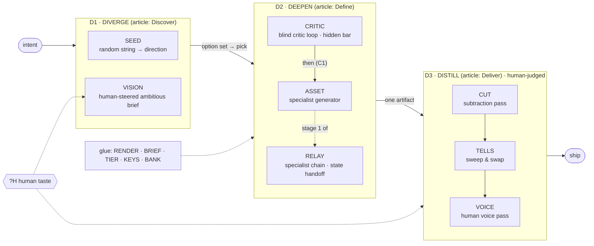

# Off-Center: a protocol for distinctive AI work

*Off-Center is a working name. It refers to the article's bell curve: AI slop sits in the center, and distinctive work lives in the tails.*

This protocol generalizes the eight techniques in Anshu Chimala's **"How to turn your AI into a world-class designer"** (*Lenny's Newsletter*, Sep 1 2026) beyond UI design.

- Each technique becomes a **lego block**.
- A small **grammar** connects the blocks: sequence, parallel, nest, relay, loop and human checkpoint.
- **Seven configurations**, plus **C6a** (a fiction variant of C6), wire the blocks for researched use cases. Some blocks sit out of some configurations.
- The article's own design workflow is **C1 Studio**.

## How this was built

Two research workflows produced the material:
- One generalized each technique against primary sources.
- One researched pain points and market realities across eleven use cases.

Two review rounds followed:
- A skeptic spot-checked the use-case research.
- A six-agent adversarial review checked the protocol. It covered article fidelity, internal consistency, scope discipline and practitioner usefulness, and re-checked 55 citations.

Everything both rounds found has been fixed, and every change is logged in [04 · Corrections](04-use-case-evidence.md#corrections). A later external review of byway (2026-10-08) found the summaries' seed-string wording broader than its source; the narrowed wording is logged there as Round 3. Anything substantially different from the article went to [More to Explore](05-more-to-explore.md).

---

## The idea in one paragraph

Preference-tuned models settle every open decision with the most typical, please-everyone option. The same defaults recur across runs, users and even model families, and models add material far more readily than they remove it. The article's goal is the **feeling** the work evokes: "focus on the feeling." Distinctiveness is how you get there. Its method has four parts:

- **Bring variety in from a seed or a human,** never from "be creative."
- **Separate judgment from production:** a stronger critic, in a fresh context, sees only the rendered result.
- **Delegate to specialists** for what the generalist agent can only fake.
- **Subtract, audit and re-voice after generation,** instead of banning things before it.

## System map

## The eight blocks → [01-blocks.md](01-blocks.md)

| Code | Block | From technique | What it fights |
|---|---|---|---|
| `SEED` | External Seeding | T1 seed strings | Mode collapse: "be random" still gets you the mode |
| `VISION` | Taste-Steered Brief | T2 ambitious prompts | Defaults filling every open decision; pasting AI ideas straight back |
| `CRITIC` | Blind Critic Loop | T3 subagent feedback | Self-review bias; the generator deciding it's "done" |
| `ASSET` | Specialist Asset | T4 image generation | Code-drawn gradients and shapes standing in for real assets |
| `RELAY` | Specialist Relay | T5 video generation | Seams and un-layerable output from independent calls |
| `CUT` | Subtraction Pass | T6 cut elements | The additive default |
| `TELLS` | Tell Sweep & Swap | T7 remove AI tells | Ubiquitous defaults that read as autopilot |
| `VOICE` | Human Voice Pass | T8 rewrite copy | One shared AI voice |

Each block separates **"Keep from the article"** (the article-faithful core) from **"Additions ⟨A⟩"** (what this protocol adds).

## The grammar → [02-grammar.md](02-grammar.md)

- **Chassis:** three stages, Diverge → Deepen → Distill.
- **Operators** (sequence, relay, replicate, map, lanes, parallel audit, pick, nest, isolate, loop-until, gate, retry, human, route, backtrack, optional), plus notation conventions. How loops fail is defined once.
- **16 typed ports**, with **8 hard rules** about what may flow between blocks. Examples: critics see only rendered views; the tell catalog never enters a generation prompt; no metric may use an AI-detector score.
- **A budget model.**

## The seven configurations → [03-configurations.md](03-configurations.md)

| | Configuration | Serves | Shape |
|---|---|---|---|
| **C1** | **Studio** *(the article)* | AI-built pages and apps · decks · brand-system UI | Seeded fan-out → a critic loop per candidate → image enrichment → human pick → optional video → human distill |
| **C2** | **Divergence Engine** | Strategy options, concepts, naming, research ideas | Wide fan-out → dedupe → annotate → human pick. Can feed C1, C3 and C5 |
| **C3** | **Voice Series** | Bylined and brand writing · teaching units | Outer loop across a series; a periodic portfolio review rotates the seeds |
| **C4** | **Reader-Ready** | Internal memos, PRDs, updates | Short linear chain; a recipient-critic for long documents only |
| **C5** | **Media Relay** | Ads · *(provisional)* brand imagery and creator video | Specialist chain as the medium, with per-shot defect checks and a one-shot gate |
| **C6** | **Sounding Board** | Cover letters, proposals, grants, relational posts | Inverted: the human writes and the blocks audit in parallel |
| **C6a** | **Fiction Sounding Board** *(variant of C6)* | Short stories, novels, serials, scripts | Seeded premise/form cards → your pick → C6's inverted loop, with a fiction tell catalog and published-passage references |
| **C7** | **Lean Diff** *(adjacent)* | Agent-written code | Subtraction on both sides of a reviewability loop; correctness comes from tests outside the blocks |

- To choose one, use the [configuration chooser](03-configurations.md#choosing-a-configuration).
- To design a new one, follow the [10-step recipe](03-configurations.md#building-a-new-configuration).
- To run one, see [06-runbook.md](06-runbook.md): prompt templates, rendering, critic isolation, file layout.
- A platform-level *channel candidate* lives in [05 §J](05-more-to-explore.md#j-channel-candidate-platform-guardrail).

## Ten default rules

A configuration may relax one only with a **declared exception** ([03](03-configurations.md#ordering-principle-and-declared-exceptions)).

1. Variety comes from a seed or a human, never from "be creative." *(article prescription)*
2. Go broad before deep, and pick before you spend ⟨A⟩.
3. Judgment is separated from production. Judges are isolated, see only views, and use a frozen prompt.
4. The critic's independent score decides when to stop, against a threshold the critic never sees.
5. Use a big model for judgment and a capable model for execution.
6. Delegate to specialists, and verify in the real render.
7. Distill only after Deepen settles, in the order CUT → TELLS → VOICE ⟨A⟩ (inferred from the article's order).
8. Audit after generation; never ban up front. Subtract with removal verbs ⟨A⟩.
9. Humans own the words readers attribute to them.
10. Bank what failed, and retest it when new models ship.

## How sure each part is

- **Evidence-backed:**
  - Self-review needs external feedback.
  - Unanchored LLM judges are unreliable (mostly older-model evidence).
  - Models are biased toward adding (task-dependent).
  - Sameness persists across models and temperatures.
  - Heavy LLM users detect AI non-fiction by majority vote. Lay readers use flawed cues, yet still penalize suspected AI.
- **Mixed:** ranking against references aligns better with humans, but it is more sensitive to distractors.
- **Article prescription** (untested elsewhere):
  - A shell-generated seed string driving a design workflow. SSoT's main tests used a string the model writes itself; its comparisons with external randomness used other tasks, where model-written strings generally did better ([01 · SEED](01-blocks.md#seed--external-seeding)).
  - Hiding the critic's threshold.
  - Auditing tells after generation instead of banning them.
- **⟨A⟩ Amendment:** added by this protocol. Marked in 01 ("Additions ⟨A⟩" lists and inline marks), in 02, in C1's amendments table, and inline in the other configurations, so the article-faithful wiring stays recoverable.

## Limits

- **No correctness guarantee.** CRITIC judges taste, not truth. Facts, citations, code correctness and security need verification outside these blocks. A `VERIFY` block is the top candidate for v2.
- **Critic reliability is unmeasured for current models.** Evidence from older models puts unanchored judges near chance on UI and prose. Hence the calibration step, and the preference for GREAT mode (ranking against references).
- **Not for evading detection.** No gate or success metric uses an AI-detector score. Required disclosures, platform AI labels and provenance are always preserved. No configuration invents facts about a person.
- **Unproven end to end.** No study has tested any configuration as a whole, and conversion lift for distinctive AI pages is unmeasured. [05](05-more-to-explore.md) proposes the experiments.
- **Cost.** Critic cost is driven by image inputs, and each candidate multiplies it. See the [budget model](02-grammar.md#7-budget-model-a) and the per-configuration **lite** profiles.

## Files

| File | What it holds |
|---|---|
| [01-blocks.md](01-blocks.md) | The eight blocks: mechanism, procedure, ports, knobs, guards, fit by domain, wiring, evidence; article core vs. ⟨A⟩ additions; glue |
| [02-grammar.md](02-grammar.md) | Chassis, operators, loop failure semantics, ports, port rules, compatibility, sit-outs, default rules, budget model |
| [03-configurations.md](03-configurations.md) | Seven configurations plus the C6a fiction variant, with wiring, diagrams, sit-outs, guardrails, stop rules, cost, lite profiles, success criteria, amendments; chooser; recipe |
| [04-use-case-evidence.md](04-use-case-evidence.md) | Anchored scoring rubric, use-case cards with counter-evidence, rejected use cases, cross-cutting findings, gaps, corrections |
| [05-more-to-explore.md](05-more-to-explore.md) | Off-path findings, a shortlist of 8 future-block candidates, the platform channel candidate |
| [06-runbook.md](06-runbook.md) | Prompt templates, render script, critic isolation in Claude Code, file layout, numeric rules |
| [SOURCES.md](SOURCES.md) | 310 sources, de-duplicated; ✓ marks those an agent confirmed |
| [map/off-center-map.html](map/off-center-map.html) | The visual map: the patch panel of blocks, wiring diagrams, coverage, rubric, chooser |
